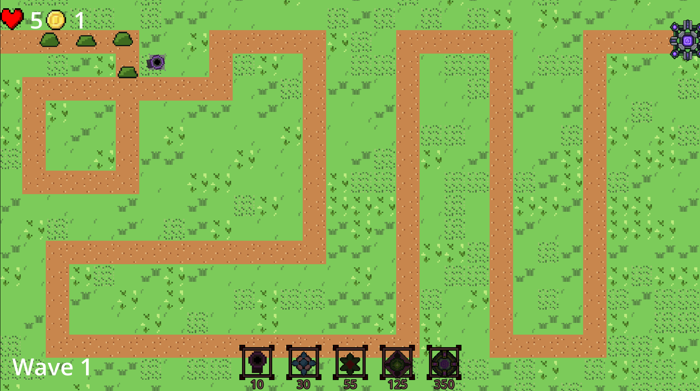

<h1 align="center">🛡️ Outbreak TD</h1>

<p align="center">
  <b>A strategic 2D Tower Defense game built with Godot 4.</b>
</p>

<div align="center">
  
  <br><br>
  <a href="#"></a>
  <a href="#"></a>
  <a href="#"></a>
</div>

<br>

## 📖 The Story

The outpost is under siege! Waves of relentless creatures are marching down the path to destroy your Home Base. You are the last line of defense. 

Manage your gold wisely, place powerful turrets, and survive the onslaught. Your base only has **5 HP**, and you only start with **10 Gold**. Can you build the ultimate defense and survive all 28 standard waves, plus the secret final boss wave?

<br>

## 🎮 Controls

<div align="center">

| Action | Key / Input |
| :--- | :--- |
| **Select Tower** | <kbd>1</kbd> <kbd>2</kbd> <kbd>3</kbd> <kbd>4</kbd> <kbd>5</kbd> *(or click UI)* |
| **Place Tower** | <kbd>Left Mouse Click</kbd> |
| **Cancel Placement** | <kbd>Right Mouse Click</kbd> |
| **Pan Camera** | <kbd>W</kbd> <kbd>A</kbd> <kbd>S</kbd> <kbd>D</kbd> |
| **Zoom Camera** | <kbd>Mouse Wheel</kbd> |

</div>

<br>

## 🗼 Your Arsenal

You have 5 unique towers to build. Place them on the green grass—except for the Mine, which must be placed on the enemy path!

1. **Sentry Gun (Cost: Low):** Your standard rapid-fire turret. Great for picking off early waves.
2. **Laser Tower (Cost: Medium):** Locks onto a target and deals continuous damage-per-second. Excellent for high-health enemies.
3. **Plant Tower (Cost: Medium):** Fires a radial burst of 6 projectiles in all directions. Great for crowds.
4. **Ice Tower (Cost: Medium):** Applies a slowing AOE effect to enemies, buying you and your other towers more time.
5. **Grass Mine (Cost: Low):** Must be placed **ON THE PATH**. Explodes when stepped on, dealing massive AOE damage and firing 8 pieces of shrapnel!

<br>

## 🏆 How to Beat the Game

1. **Manage your Economy:** You start with only 10 gold. Kill enemies to earn more gold. If enemies reach the end of the path, they damage your base (and you don't get paid for them!).
2. **Build Strategically:** Place towers near the corners of the path so they stay in range of enemies longer. 
3. **Adapt to Waves:** Later waves introduce tougher enemies like Blue Ants, Soldiers, and Crawlers with increased health. 
4. **Use the Mine:** Place mines on the path right in the middle of your turret clusters to trigger massive chain reactions!
5. **Survive:** The game ends in victory after you survive Wave 28. But be careful... a massive staged "Boss Wave" (Wave 29) awaits if you trigger the endless mode!

<br>

## 🛠️ How to Run the Project in Godot

If you want to open this project in the Godot Engine and look at the code:

1. Download and install **[Godot Engine (v4.x)](https://godotengine.org/download)**. *(Standard version, no C# needed)*.
2. Clone this repository to your computer:
   ```bash
   git clone https://github.com/KenjiLao-20/OutbreakTD-Game.git
   ```
3. Open the **Godot Project Manager**.
4. Click the **Import** button.
5. Click **Browse** and navigate to the folder where you cloned the repository. Select the `project.godot` file.
6. Click **Import & Edit**.
7. Once the editor opens, press <kbd>F5</kbd> (or click the Play button in the top right) to run the game!

<br>

## 📂 Project Structure

* 📁 `Scenes/` - Contains all the game scenes (Towers, Enemies, UI, Main Map).
* 📁 `Scripts/` - Core game logic.
  * 📄 `GameManager.gd` - The Autoload singleton tracking coins, base health, and wave state.
  * 📄 `main_map.gd` - Handles tower placement, tile validation, and UI integration.
  * 📄 `spawner.gd` - Controls the wave logic, enemy scaling, and spawn timers.
  * 📄 `BaseTower.gd` - The parent class for all towers handling targeting and shooting.
  * 📄 `BaseProjectile.gd` - The parent class for all projectiles (handles piercing and lifetime).
* 📁 `Assets/` - Contains the tilesets, character sprites, sound effects, and UI elements.

<br>

---
<div align="center">
  <i>Made with ❤️ using Godot Engine.</i>
  <br><br>
  <small><b>Developer Secret:</b> You can change the starting gold, base HP, and enemy health scaling in the <code>GameManager.gd</code> export variables!</small>
</div>
